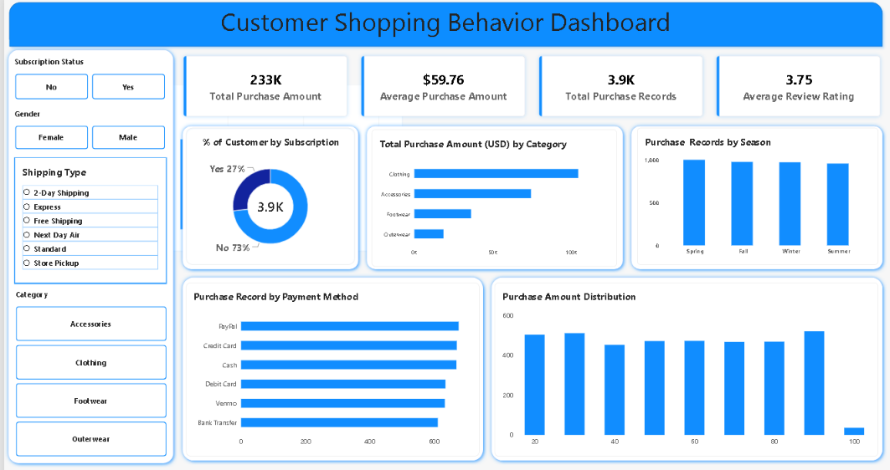

# Consumer Shopping Behavior Analytics

## Project Overview

This project analyzes consumer shopping behavior using
Python, SQL, statistical analysis, and Power BI.

The goal is to explore shipping type, product
categories, payment methods, purchase amount by category, customer
demographics, seasonal activity, review rating and % of customer by subscription.

## Business Objectives

- Analyze purchase amounts across product categories.
- Compare shopping activity across seasons.
- Understand payment method distribution.
- Examine purchase amount distribution.
- Explore customer demographic patterns.
- Summarize review ratings.
- Develop data-supported business recommendations.

## Tools and Technologies

- Python
- Pandas
- Matplotlib
- Seaborn
- MySQL
- SQL
- Power BI

## Project Workflow

1. Data inspection
2. Missing-value and duplicate analysis
3. Data cleaning using Python
4. Exploratory Data Analysis (EDA)
5. Statistical analysis
6. SQL-based analysis
7. Power BI dashboard development
8. Business insights and recommendations

## Dashboard Features

- KPI cards
- Category analysis
- Seasonal purchase analysis
- Payment method analysis
- Subscription status
- Customer demographic analysis
- Purchase amount distribution
- Interactive slicers

## Repository Structure

- `notebooks/` — Python analysis scripts
- `sql/` — SQL queries
- `reports/` — Analysis reports and charts
- `README.md` — Project documentation

## Key Findings

See `reports/eda_summary.txt`,
`reports/statistical_analysis.txt`, and
`reports/business_insights.txt` for the actual
analytical results.

## Business Recommendations

See `reports/final_business_recommendations.md`.

## Limitations

- Findings describe the available dataset.
- Observed patterns do not establish causation.
- Profit cannot be calculated without cost data.
- Purchase records should not automatically be treated
  as unique customers or verified repeat transactions.

## Dashboard Preview

## Author

Data Analytics Portfolio Project
